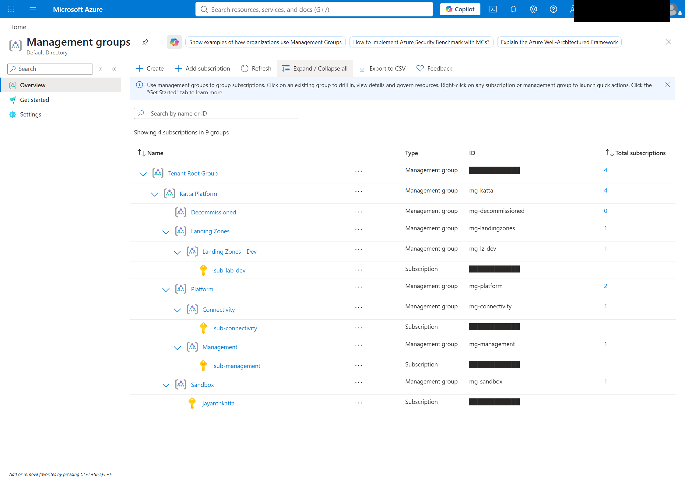
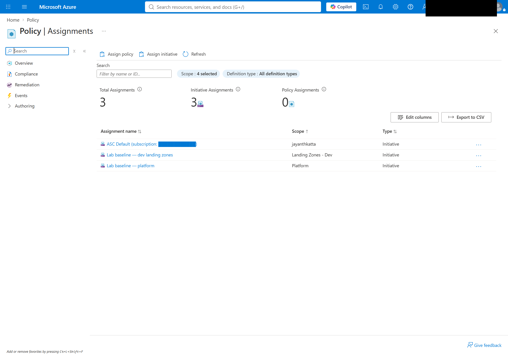

# Week 01 — The landing zone, deployed

A management group tree is a diagram until something is assigned to it. This
week makes it govern, and proves it by getting a deployment denied.

---

**Reproduce it:** [LAB.md](LAB.md) — prerequisites, variables, commands, expected outputs, validation and cleanup.
**Write-up:** [jayanthkatta.com/blog/week-01-azure-landing-zone](https://jayanthkatta.com/blog/week-01-azure-landing-zone/)

---

## 1. Cost note

**$0.** Azure Policy definitions, assignments and compliance evaluation are free
at any scale. The test bed is a virtual network, a subnet and two network
interfaces, all created and destroyed within the session — under a penny in
total. Nothing runs continuously and nothing is left up.

`scripts/cleanup.sh` removes everything, including the parts that do not live in
a resource group. See **Teardown** below, which is the most useful thing in this
week.

---

## 2. What gets built

| | |
| --- | --- |
| Custom definition | `deny-public-ip-on-nic`, defined at `mg-katta` |
| Initiative | `initiative-lab-baseline` — allowed locations, required tag, no public IP |
| Assignments | At `mg-lz-dev` (staged) and `mg-platform` (always enforcing) |
| Test bed | `rg-wk01-landing-zone-dev-scus-001` — a VNet and a subnet |

Three scopes are in play and they are deliberately different:

- The **definition** is created at `mg-katta`. A definition can only be assigned
  at or below where it is defined, so putting it at the intermediate root makes
  it usable by every tier and invisible outside the lab.
- The **assignments** target `mg-lz-dev` and `mg-platform`. Neither ever names a
  subscription. Any subscription placed under those groups later is governed
  automatically, including ones that do not exist yet — that inheritance is the
  entire reason the tree exists.
- The **test bed** is a resource group, because that is the only scope whose
  deletion is atomic and complete.

---

## 3. The hierarchy this governs



Four subscriptions in nine groups. The baseline is assigned at **Landing Zones -
Dev** and at **Platform** — never at a subscription, and never at Tenant Root
Group.



Both assignments are initiatives at management group scope. Neither one names a
subscription anywhere.

---

## 4. The custom rule

```
Microsoft.Network/networkInterfaces/ipConfigurations[*].publicIpAddress.id
```

The `[*]` matters. A NIC can carry several IP configurations, and an alias
without the wildcard would inspect only the first — passing a NIC whose *second*
configuration is public. With `[*]`, the condition is true if any configuration
has one.

The effect is a **parameter**, not a constant, which is what allows the same
definition to be assigned in reporting mode and enforcing mode without editing
it.
