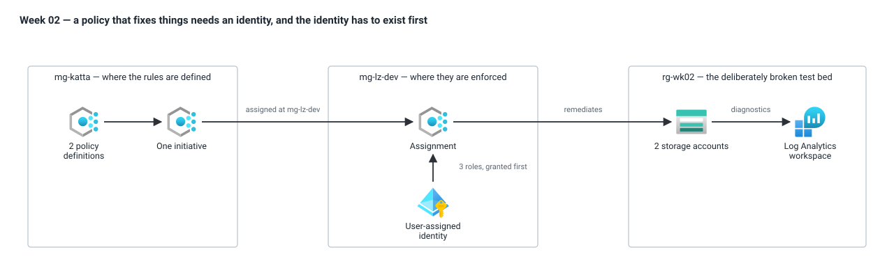

# Week 02 — Policy as code

Week 01 proved a `deny`. A deny governs the next deployment and nothing else —
it is a gate, and gates do not fix what is already inside. This week is the
other half: policy that reaches into an estate that already exists and changes
it, which means a managed identity, which means a role assignment, which is
where this stops being about policy and starts being about access.

---

**Reproduce it:** [LAB.md](LAB.md) — prerequisites, variables, commands, expected outputs, validation and cleanup.
**Write-up:** [jayanthkatta.com/blog/week-02-policy-as-code](https://jayanthkatta.com/blog/week-02-policy-as-code/)

---

## 1. Cost note

**Under $1.** Policy definitions, assignments, compliance evaluation and
remediation tasks are free at any scale. The test bed is a Log Analytics
workspace and two Standard LRS storage accounts, up for a few hours: the
workspace ingests a few MB of storage metrics against a 5 GB/month free
allocation, and the storage accounts hold nothing. Retention is left at the
30-day free floor, because retention beyond it is the part of Log Analytics
that bills.

`scripts/cleanup.sh` removes everything, including the three role assignments
at management group scope that survive deletion of the resource group. See
**Teardown**.

---

## 2. What gets built

| | |
| --- | --- |
| `deployIfNotExists` definition | `dine-storage-diagnostics-to-law` — any storage account without a diagnostic setting pointing at the lab workspace gets one deployed |
| `modify` definition | `modify-inherit-tag-from-rg` — resources inherit `cost-center` from their resource group |
| Initiative | `initiative-lab-remediation`, both rules, defined at `mg-katta` |
| Assignment | `assign-remediation-dev` at `mg-lz-dev`, carrying a user-assigned identity |
| Identity | `id-wk02-policy-remediation`, granted three roles at `mg-lz-dev` |
| Test bed | `rg-wk02-policy-as-code-dev-scus-001` — a workspace and two deliberately non-compliant storage accounts |

---

## 3. How it fits together



---

## 4. The design decision: user-assigned, not system-assigned

A policy assignment holds exactly one managed identity either way, so this is
not a question of how many. It is a question of ordering.

A **system-assigned** identity does not exist until the assignment that owns it
exists. Its principal ID cannot be known before then, so the role assignment can
only be created afterwards — and Azure begins evaluating the assignment the
moment it is created. The window between "the assignment exists" and "its
identity can do anything" is real, and every remediation that starts inside it
fails. It is also fragile across changes: replace the assignment and every grant
attached to the old principal is orphaned, pointing at an object ID that no
longer resolves.

A **user-assigned** identity inverts that. Create the identity, grant it, then
hand it to the assignment:

```hcl
resource "azurerm_user_assigned_identity" "remediation" { ... }

resource "azurerm_role_assignment" "remediation" {
  for_each     = var.grant_remediation_roles ? local.roles : {}
  scope        = var.lz_dev_management_group_id
  principal_id = azurerm_user_assigned_identity.remediation.principal_id
}

resource "azurerm_management_group_policy_assignment" "dev" {
  identity {
    type         = "UserAssigned"
    identity_ids = [azurerm_user_assigned_identity.remediation.id]
  }
  depends_on = [azurerm_role_assignment.remediation]
}
```

The `depends_on` is not decoration. Terraform sees the assignment reference the
identity, not the grants, so without it the assignment is free to be created
first — reintroducing exactly the race that user-assigned was chosen to remove.
