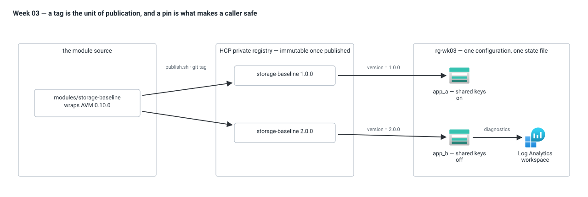
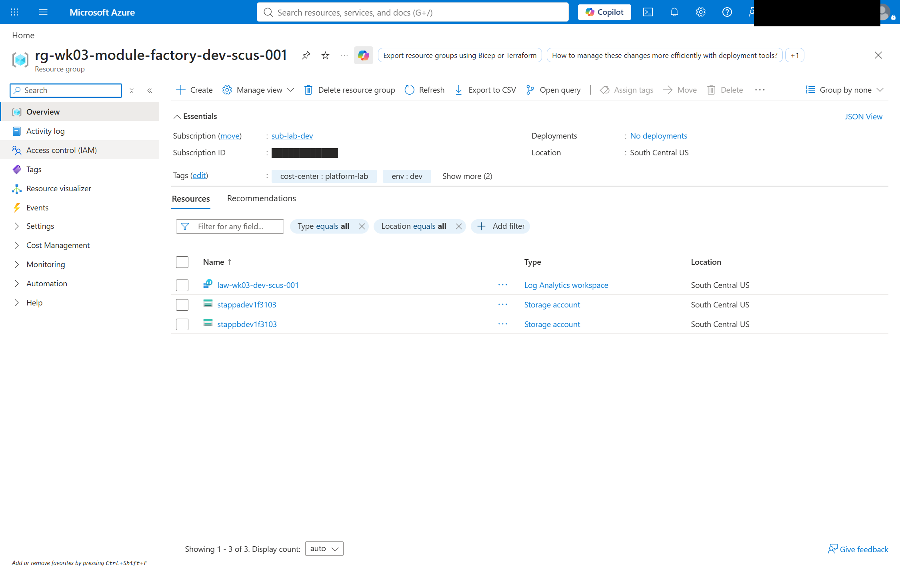
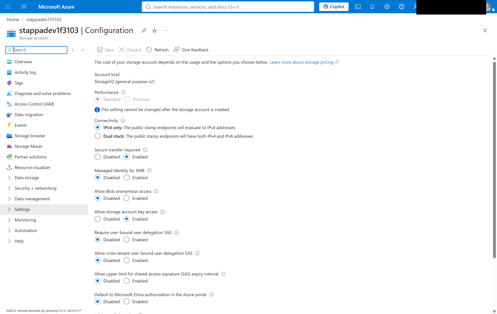
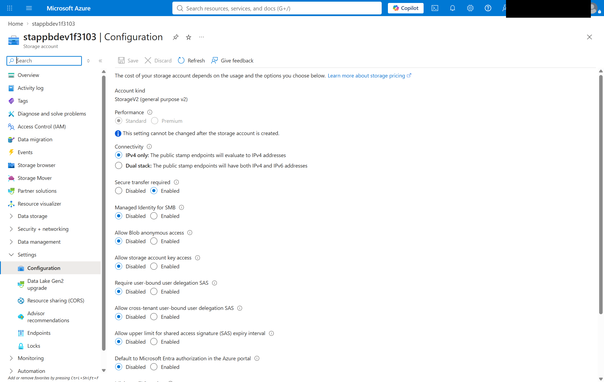

# Week 03 — A module factory on Azure Verified Modules

A private module registry, a golden module published to it by git tag, and two
consumers pinned to two different majors of that module in one state file.

The week's claim: **a private registry is not a convenience, it is what makes a
version pin mean something.** The proof is what happens to an existing consumer
when a breaking major lands beside it.

---

**Reproduce it:** [LAB.md](LAB.md) — prerequisites, variables, commands, expected outputs, validation and cleanup.
**Write-up:** [jayanthkatta.com/blog/week-03-module-factory](https://jayanthkatta.com/blog/week-03-module-factory/)

---

## 1. Cost note

Deployed continuously while the week is up:

| Resource | SKU | What it costs at rest |
| --- | --- | --- |
| 2 × storage account | Standard LRS, StorageV2 | Billed per GB stored and per transaction. Both accounts hold one empty container |
| 1 × Log Analytics workspace | PerGB2018, 30-day retention | Billed per GB ingested. 30 days is the retention floor that carries no retention charge |

Nothing here has a per-hour price — no compute, no gateway, no firewall. The
bill is driven by data, and this week stores and ingests essentially none.

`scripts/cleanup.sh` deletes the whole resource group, which removes every
resource above. It deliberately **keeps** the published registry versions unless
given `--registry`: unpublishing a version breaks every configuration pinned to
it, which is the opposite of the property this week exists to demonstrate.

---

## 2. How it fits together

---

## 3. The design

### Consume AVM, wrap it in this lab's own module

`storage-baseline` creates nothing itself. Every resource comes from
`Azure/avm-res-storage-storageaccount/azurerm`, pinned to an exact `0.10.0`.
What the wrapper adds is everything AVM deliberately has no opinion about — AVM
ships a *correct* storage account, a platform team needs *their* storage
account, and the difference between those two is the wrapper.

A caller passes a workload word and gets back four things they would otherwise
get wrong: a name that is valid, unique and derivable; transport and public
access already at the lab's baseline; the `cost-center` tag the estate's tagging
policy enforces; and diagnostics wired up from a single workspace ID.

**The AVM pin is exact, and that is a different decision from the one a consumer
of this module makes.** A wrapper's job is to be the stable thing. On `~> 0.10`
a caller pinned to `storage-baseline` 1.0.0 could still have their storage
account change underneath them, which is precisely what pinning was supposed to
buy them. AVM is also pre-1.0, where a minor bump is permitted to break.

### Publishing is by tag, through the API

`publish.sh` builds the tarball with `git archive <tag>:<path>` — never from the
working tree. A registry version is immutable, so a tarball built from a dirty
checkout publishes a version that matches no commit, and the only correction
available is deleting a version other configurations may already be pinned to.

The API path rather than a VCS connection is what lets a monorepo publish one
subdirectory without splitting each module into its own repository.

### One workspace ID in, two diagnostic settings out

A storage account emits no logs of its own — only the `Transaction` metric. The
read, write and delete audit events belong to the blob *service*, a separate ARM
resource at `.../blobServices/default` with its own diagnostic setting. Asking
for `allLogs` on the account is accepted and produces nothing, which is a thing
discovered during an incident rather than during a deploy.

---

## 4. The two kinds of breaking change

`storage-baseline` 2.0.0 carries one of each, deliberately:

| | Change | How it reaches you |
| --- | --- | --- |
| **Loud** | `log_analytics_workspace_id` becomes required | `Missing required argument`, at plan. Nothing deploys |
| **Silent** | `shared_access_key_enabled` defaults `true` → `false` | No plan error, no apply error. Whatever authenticated with a shared key stops working at runtime |

The silent one is what makes major versions worth the trouble. A constraint like
`~> 1.0` would have caught neither, because both changes are in a new major —
and a team that writes `~> 2.0` after upgrading has re-armed the silent one for
2.1.0.

---

## 5. Evidence

| | |
| --- | --- |
|  | The resource group: two storage accounts from one module at two majors, plus the workspace |
|  | `stappadev1f3103`, built from 1.0.0 — **Allow storage account key access: Enabled** |
|  | `stappbdev1f3103`, built from 2.0.0 — **Disabled**. Every other setting on the blade is identical |
