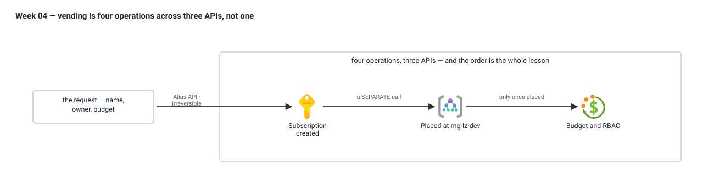
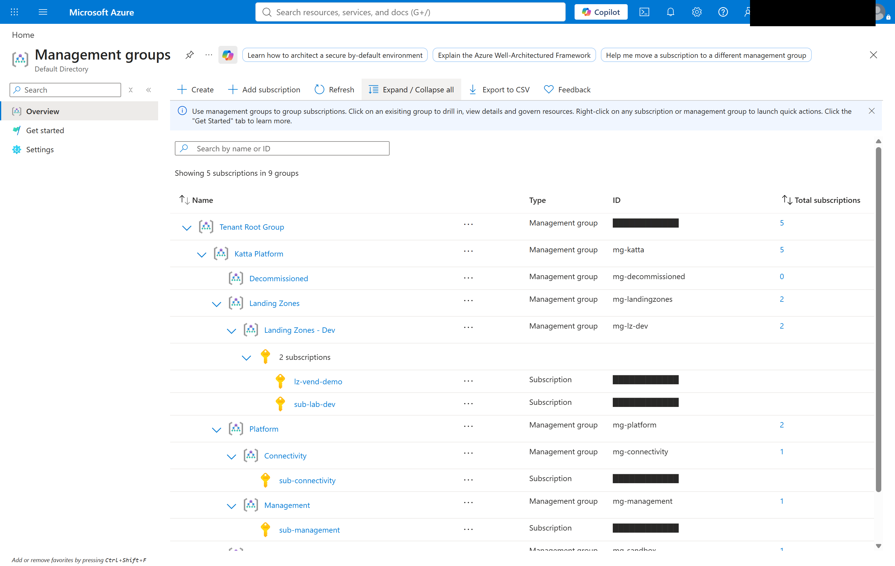
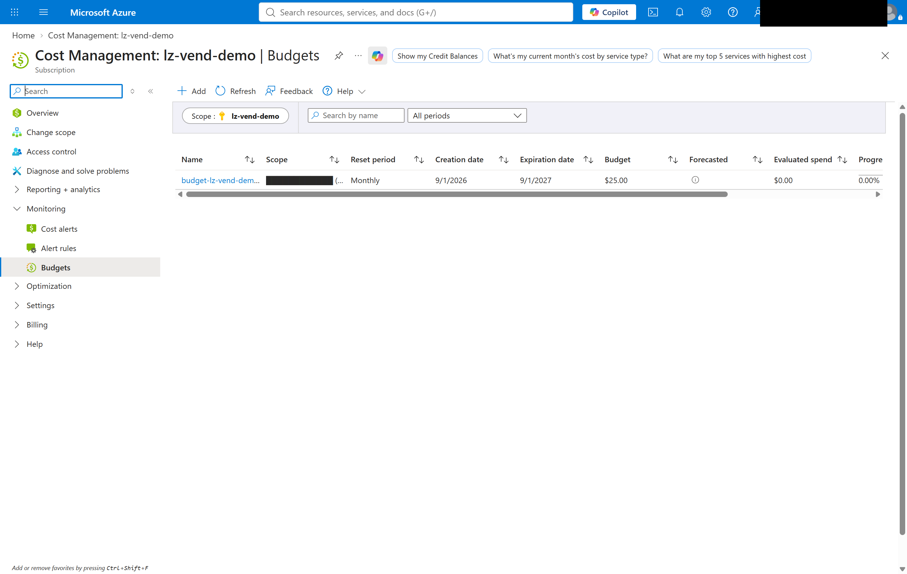
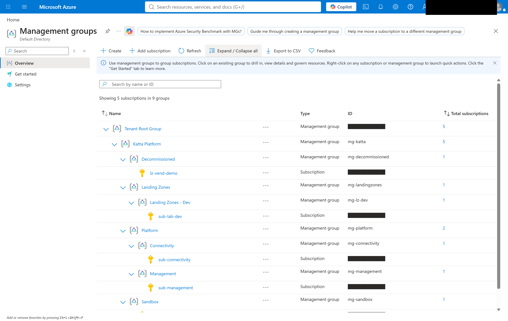

# Week 04 — Subscription vending

The bootstrap created three subscriptions by hand, one at a time, watching each
one. This turns that into a pipeline: a request goes in, and a landing zone comes
out created, placed, budgeted and granted, with no portal step.

The week's claim: **vending is easy and de-vending is not.** Creating a
subscription is four API calls. Getting rid of one is a three-day wait you cannot
shorten, and the interesting engineering is all on that side.

---

**Reproduce it:** [LAB.md](LAB.md) — prerequisites, variables, commands, expected outputs, validation and cleanup.
**Write-up:** [jayanthkatta.com/blog/week-04-subscription-vending](https://jayanthkatta.com/blog/week-04-subscription-vending/)

---

## 1. Cost note

Nothing here has a per-hour price. A subscription costs nothing to exist, and a
budget and a role assignment are free. The bill is whatever gets deployed
*into* a landing zone, which is the next week's problem by design.

| Resource | Cost |
| --- | --- |
| Vended subscription | none, empty |
| Cost Management budget | none |
| Role assignment | none |

`scripts/cleanup.sh` destroys the payload. It cannot delete the subscription —
see **Teardown**, which is the most useful section of this README.

---

## 2. How it fits together

---

## 3. Vending is four operations across three APIs

Only the first creates anything you would call a subscription:

| | Operation | API | Measured |
| --- | --- | --- | --- |
| 1 | create | Subscription Alias | **2m16s** |
| 2 | place | Management Groups | 5s |
| 3 | budget | Consumption | 7s |
| 4 | grant | Authorization (RBAC) | 45s |

**Step 2 is the one that gets forgotten, and its absence is invisible.** The
alias API creates every subscription under the Tenant Root Group and does not
move it. A subscription created but never placed is billed correctly, reports
healthy, and inherits no policy and no role assignments from the tree it was
supposed to land in. Nothing looks wrong until something that should have been
stopped is not.

That is why placement is a separate Terraform resource here rather than an
attribute, and why `validate.sh` checks it from both directions — that the
management group lists the subscription, *and* that the subscription reports the
management group as its parent.

---

## 4. Evidence

| | |
| --- | --- |
|  | `lz-vend-demo` under **Landing Zones - Dev**. Decommissioned shows 0 |
|  | `$25.00` monthly on the vended subscription, 9/1/2026 – 9/1/2027 |
|  | After decommission: **Decommissioned shows 1**, holding `lz-vend-demo` |
