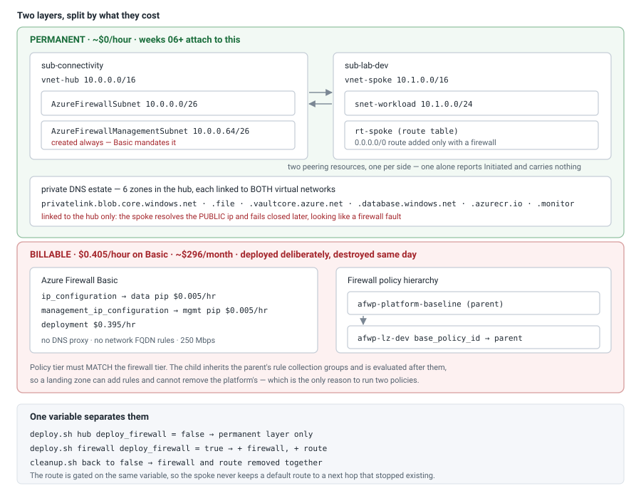
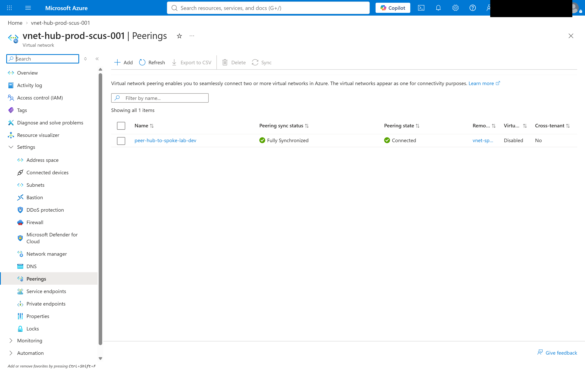
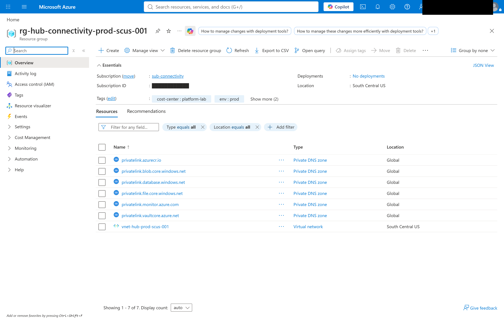
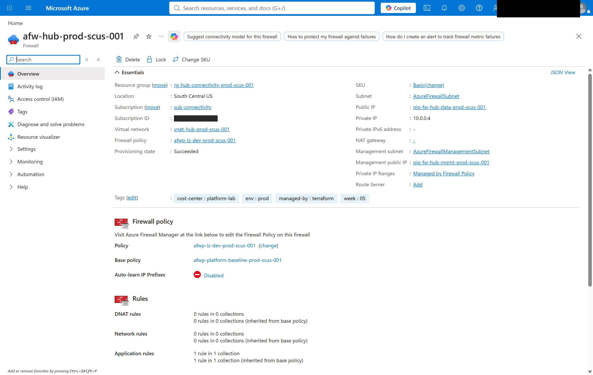
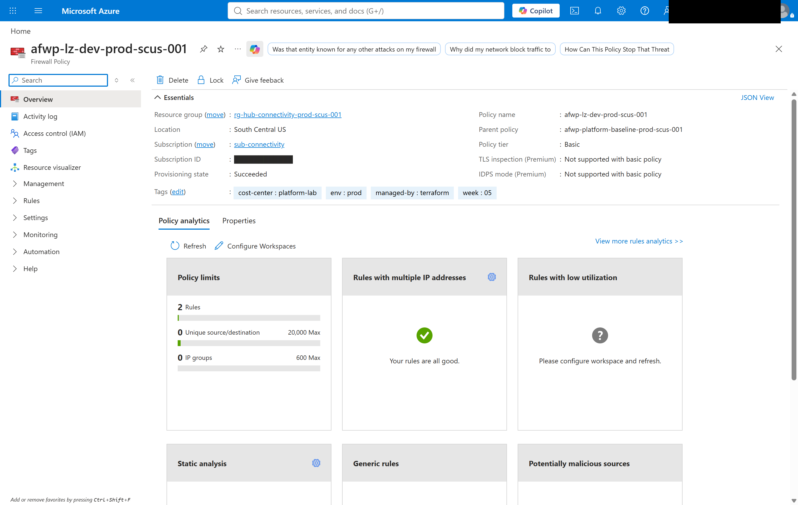
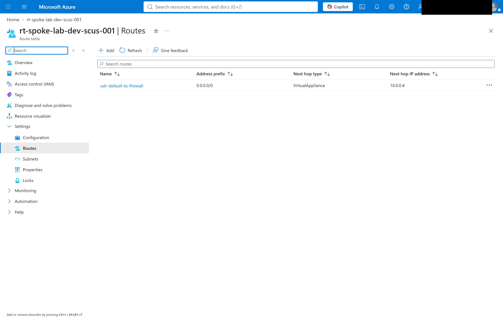

# Week 05 — The hub network

Everything later in this lab attaches to what is built here: spokes peer into
this hub, private endpoints resolve through this DNS estate, and egress leaves
through this firewall.

That makes the interesting decision the **lifecycle**, not the topology. A week
described in the roadmap as "built once, kept" cannot also be a week that bills
by the hour forever — so this one is split in two, and the split is the design.

---

**Reproduce it:** [LAB.md](LAB.md) — prerequisites, variables, commands, expected outputs, validation and cleanup.
**Write-up:** [jayanthkatta.com/blog/week-05-hub-network](https://jayanthkatta.com/blog/week-05-hub-network/)

---

## 1. Cost note

| Layer | What is in it | Cost | Lifecycle |
| --- | --- | --- | --- |
| **Permanent** | hub VNet, both firewall subnets, spoke VNet, both peerings, route table | **~$0/hour** | stays up |
| **Not free after all** | 6 private DNS zones and their 12 links | **$3.00/month** | removed 2026-10-24 — see below |
| **Disposable** | Azure Firewall Basic, 2 public IPs, 2 firewall policies | **$0.405/hour** | deployed deliberately, destroyed the same day |

Prices read from the Azure retail price API for `southcentralus` on 2026-09-19:
Basic deployment `$0.395/hour`, standard static public IP `$0.005/hour` each.
Basic requires two, so the floor is `$0.405/hour` — about **$296/month** if left
running. Standard would be `$1.325/hour`, about **$967/month**.

`deploy_firewall` defaults to **false** and `scripts/cleanup.sh` removes **only**
the firewall by default. That inverts the usual teardown on purpose: destroying
the hub by reflex would break the next six weeks to save nothing.

**Correction, 2026-10-24: the private DNS estate was never free.** This
README and the Terraform both described the permanent layer as costing
approximately nothing. Measured against the retail price list, a private DNS
zone is **$0.50/month each** — so six zones were **$3.00/month**, or
$0.0968/day, the largest standing charge in the lab and more than twice week
08's alert rule.

Worse, they were holding nothing: each zone contained only the SOA record
Azure creates by itself, and there were zero private endpoints in any
subscription. They had been pre-created for weeks that have not arrived.

They are now gated behind `deploy_private_dns`, defaulted false, exactly as
the firewall is. Recreating them is that flag plus one apply, on the day a
week actually needs a private endpoint. The reasoning for where they live when
they do exist is unchanged and still correct — per-spoke zones fail silently,
so they belong in the hub.

**What this week actually cost: $0.72.** The firewall ran 19:48–21:35 UTC,
1 hour 47 minutes, against a planned ~1 hour. Both causes were process, not
Azure, and both are written up under *What this cost in surprises*.

---

## 2. How it fits together

---

## 3. Built in this order

### 1. The hub, the spoke, and the peering between them

The hub lives in `sub-connectivity` and the spoke in `sub-lab-dev` — two
subscriptions, two providers, one configuration. That is what the bootstrap's
hierarchy is for, and this is the first week that proves the split earns its
keep: hub and spoke can be owned by different teams on different lifecycles.

**A peering is two resources, not one.** Each side is declared independently and
the link only carries traffic when both exist. One side alone sits in
`Initiated` — a resource that exists, reports healthy, and moves no packets. So
the check reads the *state*, not the existence.

### 2. The private DNS estate

Six `privatelink` zones, created in the hub and linked to **both** virtual
networks. The names are not arbitrary: each Azure service publishes the exact
zone its private endpoints register into, and a zone one character off resolves
nothing while looking entirely correct.

They live in the hub because a private endpoint must resolve to the same record
everywhere. Per-spoke zones are the classic mistake — resolution works in the
spoke that owns the endpoint and silently returns the **public** IP everywhere
else, which fails closed much later and looks like a firewall fault.

### 3. The firewall — and what Basic quietly requires

Basic is not simply a cheaper Standard. It **mandates a management NIC** — a
second subnet named `AzureFirewallManagementSubnet` and a second public IP,
neither of which Standard needs. That is a virtual network design decision, so
this hub creates the management subnet **unconditionally**, at every tier:
changing tier later is then a variable change rather than re-addressing a live
hub, and an empty /26 costs nothing.

Basic also has **no DNS proxy** ("uses Azure DNS only"), no network-level FQDN
filtering, no web categories, threat intelligence in alert mode only, and a
250 Mbps ceiling. Private endpoint resolution still works — the zones above are
linked per-VNet and resolve through Azure DNS — but the firewall cannot be the
central resolver for spokes.

### 4. The policy hierarchy

A parent policy holds what every landing zone gets and cannot remove; a child
inherits it and adds its own. Child rule collection groups are evaluated *after*
the parent's, so the parent always wins — which is the entire reason to run two.

The policy tier must **match** the firewall tier. The portal states the
consequence plainly: `TLS inspection (Premium): Not supported with basic policy`.

Note the firewall blade above reports `1 rule in 1 collection` **and**
`1 rule in 1 collection (inherited from base policy)`. That inherited line is
the hierarchy working, read from the firewall rather than from the template.

### 5. The route that makes it load-bearing

Without this, the firewall exists and carries nothing. The spoke's default route
has to point at it — `0.0.0.0/0 → VirtualAppliance → 10.0.0.4`, which is the
private IP shown on the firewall blade in step 3.

The route is gated on the same variable as the firewall, deliberately. A
`0.0.0.0/0` route to a next hop that no longer exists does not fail loudly; it
blackholes the subnet.
