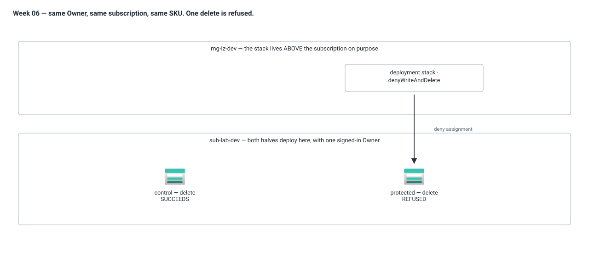
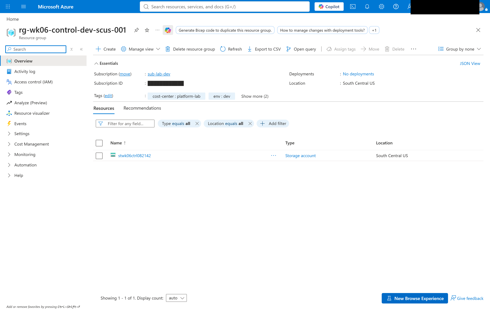
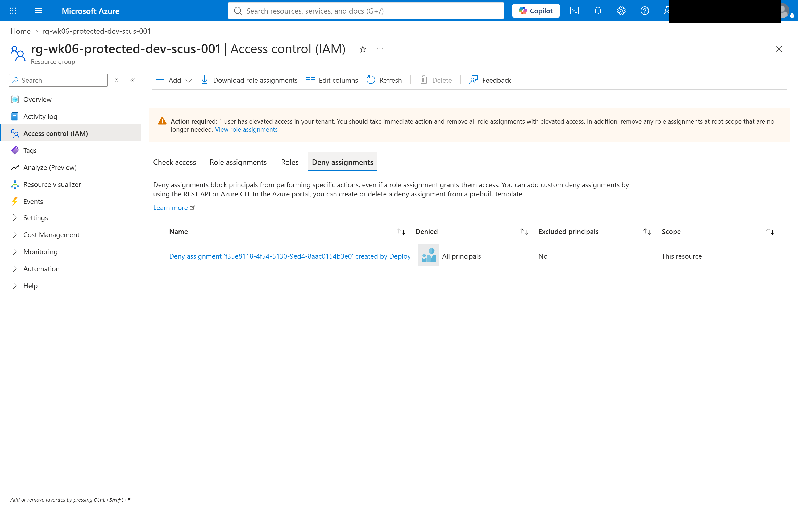

# Week 06 — Deployment stacks, and a deny that outranks the Owner

Every protection this lab has built so far can be removed by whoever it protects.
A resource lock is a resource: an Owner deletes the lock, then deletes the thing.
An Azure Policy `deny` effect is an assignment: an Owner unassigns it. The
protection and the target sit at the same scope, under the same identity, so the
control is only ever as strong as the discipline of the person subject to it.

A **deployment stack** breaks that. The stack owns a set of resources and holds a
**deny assignment** over them — and a deny assignment is not a role assignment.
It cannot be out-voted by a role. The caller in this week's test holds `Owner`
**and** `User Access Administrator` on the subscription, is told by Azure in the
error text that they *have* permission to perform the delete, and the delete is
refused anyway.

The week's claim, stated so it can fail: **an Owner with full rights over the
subscription cannot delete a resource a deployment stack is protecting, and can
delete an otherwise identical resource beside it.**

---

**Reproduce it:** [LAB.md](LAB.md) — prerequisites, variables, commands, expected outputs, validation and cleanup.
**Write-up:** [jayanthkatta.com/blog/week-06-deployment-stacks](https://jayanthkatta.com/blog/week-06-deployment-stacks/)

---

## 1. Cost note

| What runs | Cost |
| --- | --- |
| 2 storage accounts, `Standard_LRS`, `StorageV2`, empty | **~$0/hour** |
| The deployment stack, the deny assignment, the resource groups | **free** |

Storage bills for capacity and transactions. These accounts hold nothing and
serve nothing, so the run cost rounds to zero — the meter that matters is the one
this week does *not* touch. Nothing here is left running: `scripts/cleanup.sh`
removes the stack, its managed resources and the Terraform half.

**What this week actually cost: $0.00.**

The interesting cost is not money. It is that a stack with deny settings on is
harder to remove than what it protects, which is the point and also the trap —
see *Teardown* below.

---

## 2. How it fits together



---

## 3. The design

### Two halves, two tools, and that split is deliberate

```
the control     Terraform, into sub-lab-dev. An ordinary storage account,
                no protection whatsoever.
the protected   an ARM template deployed as a deployment stack created at
                mg-lz-dev scope, into sub-lab-dev, deny settings on.
```

**Deployment stacks have no Terraform resource.** Checked on 2026-09-20 against
the azurerm provider's own documentation tree: there are `*_template_deployment`
resources, and nothing for `Microsoft.Resources/deploymentStacks`. Microsoft's
guidance says the same — *"To create and update a deployment stack, use the Azure
CLI, Azure PowerShell, or the Azure portal with Bicep files."* Terraform is not on
that list, so this week does not pretend otherwise. The stack is created by
`az stack mg create` and the template is ARM JSON, which needs no extra toolchain
and is what Bicep compiles to before the stack ever sees it.

The control is not decoration. Without it, *"the delete failed"* has more than one
explanation — a typo in the account name, a transient Azure error, a missing role.
With it, the two attempts differ in exactly one variable: same subscription, same
region, same SKU, same TLS floor, same public-access setting, same identity, one
held by a stack.

### The stack is scoped ABOVE the subscription it deploys into

The stack is created at **`mg-lz-dev`** — a management group — and deploys into
`sub-lab-dev`. That scope is the security control, not a detail.

A deny assignment lives where the **stack** lives. Put the stack in the
subscription and an Owner of that subscription can reach the stack, delete it, and
take the deny assignment with it. Put the stack a level up, and lifting the
restriction requires rights at the management group — which is a different grant,
held by different people, reviewed on a different cadence.

This is also why the stack creates its own resource group rather than deploying
into one Terraform made. **A resource with two owners has an ambiguous teardown**,
and an ambiguous teardown is precisely the failure this week is about avoiding.
The stack owns everything it protects, down to the resource group.

### `denyWriteAndDelete`, and the mode that is not quite it

`--deny-settings-mode` takes `none`, `denyDelete`, or `denyWriteAndDelete`. This
week uses `denyWriteAndDelete`, because `denyDelete` leaves a wide door open: a
protected storage account whose network rules can still be rewritten, whose public
access can be re-enabled, and whose TLS floor can be dropped is not meaningfully
protected — it just cannot be removed while being quietly ruined.

---

## 4. Evidence






The deny assignment is listed in the portal under the subscription's **Access
control (IAM) → Deny assignments**, created by `Deployment stack`, with *Denied:
All principals* and *Excluded principals: No*. Nobody created it by hand and nobody
can edit it there — the stack is the only thing that changes it.

**The stack itself has no portal view at management group scope.** Opening it
returns *"This feature isn't implemented at this time."* Stacks at subscription and
resource group scope render; the management group blade does not, as of 2026-09-25.
That is a real constraint on operating them, not a gap in this week's evidence: the
deny assignment above and `az stack mg show` are the views that exist.
