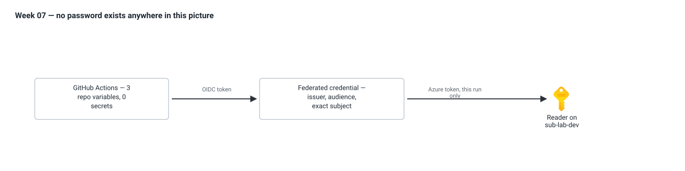

# Week 07 — A CI identity with no secret to steal

GitHub Actions deploys to Azure. Nothing in the repository is a credential.

The mechanism is **workload identity federation**: GitHub mints a short-lived
token describing the run, Azure checks it against a trust we configured once,
and hands back an access token. No password exists, so none can leak, expire,
or be forgotten in a repo.

---

**Reproduce it:** [LAB.md](LAB.md) — prerequisites, variables, commands, expected outputs, validation and cleanup.
**Write-up:** [jayanthkatta.com/blog/week-07-workload-identity](https://jayanthkatta.com/blog/week-07-workload-identity/)

---

## 1. Cost note

| What runs | Cost |
| --- | --- |
| User-assigned managed identity, federated credential, role assignment | **free** |

**What this week cost: $0.00.** Nothing here bills.

---

## 2. How it fits together

Four resources:

- **A user-assigned managed identity.** User-assigned is forced, not chosen —
  federation does not work with a system-assigned identity, because there is no
  Azure resource here to own one. The workload runs on GitHub's infrastructure.
- **A federated credential** naming the issuer, the audience, and the subject.
- **A Reader role assignment** at subscription scope.
- **A resource group** to hold the identity.

---

## 3. The subject is the security boundary

The issuer and audience are fixed strings — every GitHub repository in the
world presents the same two. **The subject is the only part that identifies
*this* repository on *this* branch**, which makes it the whole of the trust
decision.

That is also why it cannot be written by hand. GitHub defaults to immutable
subject claims, so the owner and repository each carry a numeric ID and the
documented `repo:owner/repo` form matches nothing a runner actually presents.
`deploy.sh` reads it from GitHub instead. The consequence is worth having:
renaming or transferring the repository no longer carries the Azure trust with
it.

---

## 4. Reader, not Contributor

This week's workload reads. Granting Contributor "so it works later" is how a
CI identity quietly becomes the most powerful principal in a tenant. The
workflow proves the limit by attempting a resource group create and expecting
refusal.

The assignment is at **subscription** scope, which is broader than this lab
needs — see the limitations in [LAB.md](LAB.md#8-known-limitations-and-what-production-adds).

---

## 5. Security

- **No secret exists**, rather than no secret being committed. The object cannot
  hold one.
- **Tokens are minted per run** and are short lived, so there is no rotation
  schedule to forget.
- **The trust is pinned to one repo and one branch**, exact-match, with immutable
  IDs so a rename cannot carry it.
- **Reader only**, and the workflow asserts the limit rather than assuming it.
- `permissions: id-token: write` is required in the workflow, or GitHub never
  mints a token at all — and the resulting error points at Azure rather than at
  the workflow.
