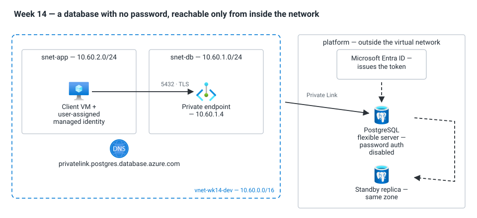

# Week 14 — A database with no password

A PostgreSQL flexible server with **no administrator account at all** — not a
strong password, not one in a key vault, none. The only way in is a Microsoft
Entra token, and the only thing holding one is a managed identity. The server
has no public endpoint, and a forced failover was performed with the downtime
measured from the client: **32.16 seconds**, inside an operation that took
the CLI six minutes to return.



## Cost note

**Measured: $0.6478.** Read from Cost Management on 2026-11-23, the day after
teardown, per the standing rule that cost comes from the bill and never from a
rate card.

| Service | Measured |
| --- | --- |
| Azure Database for PostgreSQL | $0.4403 |
| Virtual Machines | $0.1026 |
| NAT Gateway | $0.0739 |
| Virtual Network — the private endpoint | $0.0220 |
| Storage — the VM's OS disk | $0.0073 |
| Azure DNS — the private zone | $0.0016 |
| **Total** | **$0.6478** |

The **prediction** written into [`meters.json`](meters.json) before deploying
was **$1.74 for a three-hour window** at $0.5808/hour. The resources existed
from **18:21Z to 19:36Z** — one hour fifteen, which at those rates is about
$0.73. The bill came in **11% under** that.

**The last two rows are the point of yesterday's gate fix.** The private
endpoint and the private DNS zone are the meters `price_check.py` could not see
— one priced under region `Global`, one on a bare `1` unit. They are small, and
they are not zero. A DNS Private Resolver endpoint sits on the same invisible
shelf at $180/month.

**What runs continuously: nothing.** `scripts/cleanup.sh` destroys the week and
then asks Azure for the counts rather than trusting the destroy's exit code.

**This week's risk is a PER-HOUR meter, and there is no cap for that.** Week 13
could bound its exposure with `daily_quota_gb = 0.5` — ingestion stops at the
cap. Compute has no equivalent. The only bound is the clock:

| | |
| --- | --- |
| `sku_name` pinned to `GP_Standard_D2ds_v5` | 2 vCores, and the deny policy at `mg-katta` refuses anything larger |
| High availability | doubles compute to **$0.4104/hour**, and it is the point of the week |
| deploy → validate → fail over → destroy in one sitting | the only control that works on a per-hour meter |
| `if_left_running_24h` written into `meters.json` | **$13.94**, nearly double week 11's entire invoice |

## The tier decision is the whole cost story

Burstable `B1ms` is **$0.0204/hour** and would have been rejected on price
grounds by nobody. It is unusable here for a reason that has nothing to do with
money, and it was **tested rather than quoted** — asking Azure for the cheapest
possible HA server is refused outright:

```
az postgres flexible-server create --tier Burstable --sku-name Standard_B1ms   --high-availability SameZone
  -> ERROR: High availability is not supported for the Burstable tier.
```

So HA forces General Purpose at $0.1026/vCore/hour, a 2-vCore minimum, and then
HA doubles it for the standby. **A 20x price increase, driven by one feature.**

**That test exists because the documentation only rules out the zone-redundant
case.** Microsoft's HA page says zone-redundant "isn't supported for: Burstable
compute tier" and says nothing about same-zone, while the capability API lists
both modes against every Burstable SKU — the same API that claimed
zone-redundant was available in a region that then refused it. Two wrong answers
from one source: `list-skus` describes the SKU family, not what this
subscription may create.

## The cost gate had two holes, and this week found both

`scripts/price_check.py` enumerates every meter a week can bill on before
anything is deployed. On this week it reported a clean run while never having
seen two of the resources being deployed:

| Hole | What was invisible |
| --- | --- |
| The filter asked for one **region** | `Standard Private Endpoint` is priced under `armRegionName: Global` — $0.01/hour. So is every NAT Gateway meter |
| Only `1/Hour` and `1/Month` counted as recurring | A private DNS zone bills **$0.50 per zone per month** against a bare unit of `1`. So does a DNS Private Resolver endpoint, at **$180/month** |

Both are fixed. The region filter now includes `Global` and the empty region,
and a bare `1` is treated as flat — ambiguous, therefore acknowledged rather
than assumed. The second change surfaced about 110 per-notification meters on
weeks 12 and 13, which is why acknowledgement now also accepts a **pattern**:
one line, a regex, and a reason that has to name the mechanism. A pattern prints
the number of families it covers and the dearest meter among them, so the
ceiling being accepted stays on screen — `Virtual Machines::.` covers 4,287
families with a $533.70/hour ceiling, and is only defensible because the size is
pinned in Terraform *and* denied by policy two scopes up.

## What it builds

Twenty resources. One public IP, and it faces outward only.

```
terraform/
  main.tf      network, NAT gateway for egress, private DNS zone
  postgres.tf  the server, its Entra administrator, the private endpoint
  client.tf    the VM, its managed identity, and the writer that measures failover
```

**The client exists because the database is private.** It cannot be reached
from a laptop, so proving the connection and measuring the failover both have to
happen inside the virtual network. It is reached through the Azure control plane
with `az vm run-command` — no public IP, no open port, no SSH.

## No password, and the proof needs a pair

`administrator_login` and `administrator_password` are both **optional** on
`azurerm_postgresql_flexible_server`, and both are omitted:

```hcl
authentication {
  active_directory_auth_enabled = true
  password_auth_enabled         = false
  tenant_id                     = var.tenant_id
}
```

The portal's own **Reset password** button is greyed out, and `Administrator
login` reads `---`. There is no account to reset.

The client authenticates with a token it fetches for its own identity:

```bash
export PGPASSWORD=$(curl -sS -H Metadata:true \
  "http://169.254.169.254/metadata/identity/oauth2/token?api-version=2018-02-01\
&resource=https%3A%2F%2Fossrdbms-aad.database.windows.net&client_id=$CLIENT_ID" \
  | jq -r .access_token)
```

A positive result alone would prove only that *something* can log in. The
control is the same server refusing a password, and the two refusals say
different things:

```
# as the managed identity, with a password instead of a token
FATAL:  The access token has invalid format. Try again after making sure that
        the token is passed exactly as returned by the authentication endpoint.

# as the local administrator a server like this usually has
FATAL:  password authentication failed for user "pgadmin"
```

The first is the sharper one: the server does not evaluate the string as a
password at all. The second role simply does not exist.

## Validated 2026-11-22 — 10 passed / 0 failed

| Test | Result |
| --- | --- |
| High availability enabled | `SameZone / Healthy` |
| PostgreSQL password auth disabled | `Disabled` |
| Microsoft Entra auth enabled | `Enabled` |
| No local administrator on the server | none |
| Public network access disabled | `Disabled` |
| Private endpoint approved | `Approved` |
| Hostname resolves to the private endpoint | **10.60.1.4** |
| **Managed identity connects with a token** | `current_user=id-app-wk14-dev-scus-001` |
| **Password login refused** | `FATAL: The access token has invalid format` |
| Write lands in the database | 2 rows |

The DNS row matters more than it looks. The client connects to
`psql-wk14-dev-scus-001.postgres.database.azure.com` — the documented public
hostname — and inside the network it resolves to a private address. Nothing in
the connection string knows about the private endpoint.

## The failover: 32.16 seconds, inside a six-minute operation

Two forced failovers were performed the same afternoon, measured the same way:
**27.57 s** and **32.16 s** of client downtime.

```
== forced failover   19:16:12Z
  request returned 19:22:19Z -- letting the client write through it

writes attempted : 616
succeeded        : 544
failed           : 72
CLIENT DOWNTIME  : 32.16 seconds (72 failed attempts)
```

Read those two timestamps together. **The CLI call did not return for six
minutes** — it waits for the whole workflow: promote the standby, update DNS,
then build a new standby in the old primary's place. The application was
writing again after 32 seconds and never saw the rest of it. Quoting the
operation would have overstated the outage by a factor of eleven.

A writer on the VM inserts a row every 250 ms and logs the outcome with its own
clock. The gap is the longest run of consecutive failures, bounded by the last
success before it and the first after it.

**Measured from the client on purpose.** Microsoft's guidance is explicit:
*"measure the downtime from your application/client perspective"* rather than
from the operation, because the end-to-end workflow keeps running — rebuilding
a new standby — long after the application is writing again. Quoting the
operation would overstate the outage by minutes.

The only figure Microsoft publishes is for **recovery from a zone failure** on
zone-redundant HA — 60 to 120 seconds. That is a different event from a forced
failover on a healthy pair, so 27.57 s is not "better than documented", it is a
measurement of something the docs do not put a number on. One sample, on an idle
database: the docs are explicit that a busy server takes longer, because the
standby replays WAL at roughly 40 MB/s before it can be promoted.

## Four things that cost time

**The guardrail denied this week's own server.** The deny policy assigned at
`mg-katta` in the previous session matches `sku.name`, and its allowlist was
written as `GP_Standard_D2ds_v5` — the composite form Terraform and the CLI
accept. ARM stores `sku.name = Standard_D2ds_v5` with the tier in a separate
field, so **the allowlist matched nothing and the policy denied every
PostgreSQL server**, including the small ones it exists to permit.

It was proved when it was built — with a 64-vCore server, which it refused. A
deny that always fires looks exactly like a correct deny when only the negative
case is tested. The same pairing lesson as week 12's detection rules, pointed
at a policy.

**Zone-redundant HA is refused in this region.** `az postgres flexible-server
list-skus` reports `supportedHaMode: [SameZone, ZoneRedundant]` per SKU, while
the same response's region-level capability reads `zoneRedundantHaSupported:
Disabled`. The region-level flag won: the create failed with
`MultiAzHaIsOfferRestricted — Multi-Zone HA is not supported in this region`.
`ha_mode` is a variable with a validated fallback for exactly this; same-zone
costs the same and still carries a real failover.

**Egress is a design decision now, and I got the reason wrong at first.** The
NAT gateway was added believing default outbound access had been retired for new
deployments in September 2025. It has not. What Microsoft's current page says is
narrower: default outbound access is an implicit platform behaviour to avoid
relying on, the portal already creates **private** subnets, and for API versions
released after **31 March 2026** new virtual networks set
`defaultOutboundAccess = false`. The gateway is still the right build — $0.045
an hour for an egress path that does not depend on which API version created the
subnet — but **whether `apt` would have worked without it was never tested**,
and the resource group is gone, so that stays untested rather than asserted.

**`az vm run-command` does not return while a backgrounded child holds the
session's output pipe.** The first version of `failover.sh` started the writer
with `nohup ... &` and hung there for eleven minutes. `setsid` with all three
streams redirected fixes it. Separately, a refused failover request no longer
lets the script continue to "measure" an outage that never happened.

## Run it

```bash
cd terraform
cp terraform.tfvars.example terraform.tfvars   # fill in; gitignored
cd .. && bash scripts/deploy.sh                # cost gate, apply, wait for the client
bash scripts/validate.sh                       # 10 checks
bash scripts/failover.sh                       # forced failover, measured downtime
bash scripts/cleanup.sh                        # same day — this meter bills per hour
```

`terraform init` creates the HCP workspace in **remote** execution mode, which
has no Azure credentials. Fix it once:

```bash
python ../../scripts/hcp_workspace_local.py azure-week-14-dev
```

## What production adds

**A second identity, and a role that is not the administrator.** The managed
identity here is the server's Entra administrator, which made the lab's single
client self-sufficient. A real application gets its own Entra principal and a
PostgreSQL role granted only what it needs; the administrator is a group that
humans join through PIM.

**Zone-redundant HA in a region that offers it**, for the availability-zone
failure that same-zone cannot survive. Same-zone protects against a node
failure; if the zone goes, both halves go with it and recovery is a
point-in-time restore.

**Token lifetime handled properly.** A managed-identity token lasts up to 24
hours and the writer here refreshes on a timer. An application should fetch per
connection and handle the expiry it will eventually meet mid-pool.
